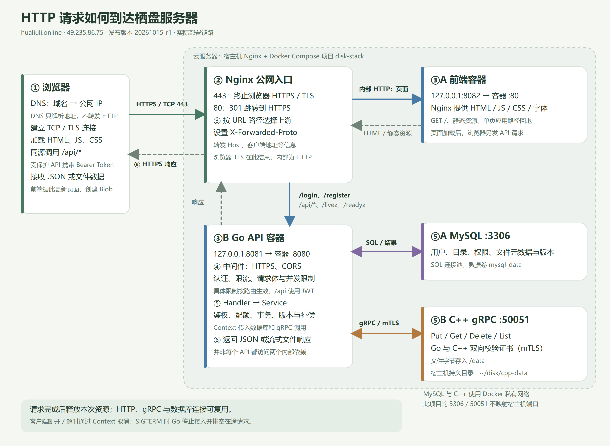

# 栖盘全量部署报告与 HTTP 请求生命周期

报告日期：2026-10-15（Asia/Shanghai）  
发布编号：`20261015-r1`  
网站：<https://hualiuli.online>  
服务器公网地址：`49.235.86.75`  
部署目录：`/home/ubuntu/disk`  
发布归档：`/home/ubuntu/releases/20261015-r1`

## 1. 发布结果

本次已更新线上 C++ gRPC 对象存储、Go API 和 React 前端。MySQL 保留现有实例、镜像和数据卷，没有执行数据库结构迁移。发布后数据库检查为 `version=2 dirty=false`，三个应用容器重启次数均为 0，前端与 MySQL 健康检查正常。

| 服务 | 本次镜像 | 宿主机入口 | 容器内入口 | 职责 |
| --- | --- | --- | --- | --- |
| 前端 | `disk_front:20261015-r1` | `127.0.0.1:8082` | `80` | HTML、JS、CSS、字体和单页应用 |
| Go API | `go_docker:20261015-r1` | `127.0.0.1:8081` | `8080` | 用户、鉴权、目录、配额、元数据与业务逻辑 |
| C++ gRPC | `cpp_docker:20261015-r1` | 未发布宿主机端口 | `50051` | 对象字节存储、gRPC 与健康服务 |
| MySQL | `mysql:8`（本次未升级） | 本项目未发布宿主机端口 | `3306` | 用户、目录、文件和版本等结构化数据 |

宿主机 Nginx 接收该站点的 80/443 请求。80 返回 301，浏览器随后通过 HTTPS 访问 443。Go 和前端的宿主机端口只绑定回环地址，由 Nginx 转发访问。本表只描述此项目，不代表服务器上其他项目或 SSH 服务的端口情况。

本次 C++ 服务指 `grpcService/disk`，构建使用自身的 `src/storage/local_store.cpp`。`objectRestore` 的独立 TCP 节点没有作为新服务加入线上 Compose。

### 1.1 源码和镜像记录

| 项目 | 源码记录 |
| --- | --- |
| Go | 基于 `6ca204b` 的当前工作区快照，包含当时的未提交改动 |
| 前端 | 基于 `4ef21b0` 的当前工作区快照，包含当时的未提交改动 |
| C++ gRPC | 本地 Git 仓库，分支 `main`，初始提交 `76411c6`；尚未配置远程仓库 |

Go 和前端没有在本次发布中创建 Git 提交或执行推送。实际发布内容由源码包校验值、镜像版本和 [发布清单](deployment-manifest-2026-10-15.json) 固定。

~~~text
cpp_docker:20261015-r1
sha256:073f274da9322cf38b6d2cee098f948f4215df3a4fbe84fad68766d9825e673a

go_docker:20261015-r1
sha256:05f0a06682edfb5b60a033bdffb23215fa821dad5186285307355080ab9ac552

disk_front:20261015-r1
sha256:ec869224e367584c4af7f0880c78015ad25d218b623572a591711941e68fec7f
~~~

## 2. 构建、备份与发布过程

1. 从本地当前代码建立独立发布快照，构建上下文不包含生产环境变量、私钥、证书目录或业务数据。
2. 前端按锁文件安装依赖，完成 TypeScript/Vite 构建，将 `dist` 放入 Nginx 运行镜像。
3. C++ 从 Git 提交导出源码并构建镜像。Go 在服务器下载依赖受阻后，改为从已测试源码交叉编译 Linux amd64、`CGO_ENABLED=0` 的服务与迁移程序，再构建运行镜像。
4. 核对本地与线上四个迁移 SQL 的校验值完全一致，确认数据库已是版本 2，本次无需 DDL。
5. 停止 Go 写入与 C++ 对象操作，备份 MySQL、对象目录、Compose、Nginx 配置和旧镜像记录。
6. 依次启动新 C++、验证新迁移工具能读取数据库版本、启动 Go 并等待 `/readyz` 成功，最后启动前端。
7. 检查公网浏览器页面、注册表单、健康接口及容器状态。

首次切换发现 Windows 交叉编译文件缺少 Linux 执行位，脚本自动恢复原镜像配置。随后在 Go 运行镜像中使用 `COPY --chmod=755` 设置两个程序的执行权限，预先验证迁移工具成功后重新发布。第二次发布成功。

### 2.1 备份

有效发布前备份位于：

~~~text
/home/ubuntu/releases/20261015-r1/backup-attempt2/
├── compose.yaml
├── nginx.conf
├── images-before.txt
├── database.sql
├── cpp-data.tar.gz
└── migration-check.log
~~~

数据库导出与对象归档期间 Go/C++ 已停止，避免数据库元数据和文件字节继续变化。备份目录权限为 700，数据备份文件为 600。报告不包含业务数据、密码、访问令牌或私钥。

发布时 SQL 备份约 16 KiB，对象归档约 122 MiB；这是当时的大小，不代表后续增长。MySQL 的 `mysql_data` 卷、C++ 的 `/home/ubuntu/disk/cpp-data` 持久目录及 TLS 只读挂载在更新容器时保留。

## 3. HTTP 请求链路图

[查看可编辑 SVG 源图](images/http-request-lifecycle-2026-10-15.svg)。

浏览器到 Nginx 是 HTTPS；Nginx 到前端/Go 是服务器内 HTTP；Go 到 MySQL 是 SQL；Go 到 C++ 是双向 TLS gRPC。它们是不同连接，不是同一份 HTTP 请求原样传到所有组件。

## 4. 一次 HTTP 请求的生命周期

### 4.1 找到服务器：DNS、TCP 与 TLS

浏览器访问 `https://hualiuli.online`，先使用缓存或 DNS 解析得到 `49.235.86.75`。DNS 只解析地址，不转发网页请求。

浏览器连接服务器 443 端口，完成 TLS 握手并验证网站证书。监听入口的是宿主机 Nginx，浏览器不直接连接 Go、C++ 或 MySQL 容器。

访问 `http://hualiuli.online` 会先在 80 端口收到 301，再发起 HTTPS 请求。域名决定“去哪台服务器”，Nginx 路径路由决定“交给哪个应用”。

### 4.2 Nginx 解密并选择上游

Nginx 在 443 终止浏览器 TLS，读取 HTTP 方法、URL、请求头和请求体，按当前配置分流：

| URL 路径 | 上游 |
| --- | --- |
| `/login`、`/register`、`/api/*`、`/livez`、`/readyz` | `http://127.0.0.1:8081` → Go |
| 其他路径，如 `/`、`/assets/*` | `http://127.0.0.1:8082` → 前端容器 |

API 转发时，Nginx 设置 `Host`、`X-Real-IP`、`X-Forwarded-For`、`X-Forwarded-Proto`。Go 通过最后一项知道外部请求使用 HTTPS，正式浏览器请求无需手工添加这个头。

Nginx 请求体上限为 `1025M`，API 请求关闭请求体代理缓冲，连接上游超时 5 秒，读写上游超时 1800 秒。Go 还会检查文件大小、并发和速率；Nginx 放行不代表业务一定接受请求。

### 4.3 获取页面，再由页面发起 API 请求

首次打开首页，前端容器返回 `index.html`。浏览器根据 HTML 继续请求 JS、CSS、字体及按需加载的模块，每个资源都是独立 HTTP 请求，可以使用缓存与既有连接。

React 加载后渲染页面。用户登录、打开目录或上传文件时，浏览器再向相同域名发起 API 请求。生产构建使用真实后端，本地开发模式的演示数据不用于线上运行。

### 4.4 Go 中间件处理请求

请求经宿主机回环端口 8081 和 Docker 映射，到达 Go 容器私网地址的 8080 端口。`net/http` 调用 Gin 路由，执行异常恢复、日志、HTTPS 和 CORS 检查。

不同路由继续执行不同约束：

- `/login`、`/register` 允许未登录用户访问，但有认证接口限流和输入校验。
- `/api/*` 验证 `Authorization: Bearer <token>`，通过后进入业务。
- 上传和搜索另有 IP/用户速率限制；上传还有并发和请求体大小限制。
- `/livez`、`/readyz` 无需登录，作为健康接口允许内部 HTTP 探测。

某一层拒绝请求时，会提前生成 HTTP 错误响应，后续业务不再执行。一个请求到达服务器不等于文件已经写入成功。

### 4.5 Handler → Service → 数据库 / 对象存储

Handler 解析输入、取得用户身份、调用 Service，并把结果映射为 HTTP 响应。Service 负责权限、目录、配额、文件引用、版本历史、事务和失败补偿。

Repository 使用数据库连接池访问 MySQL，保存结构化元数据。文件对象字节通过共享的 gRPC 客户端连接访问 C++：Go 验证 C++ 服务端证书，C++ 验证 Go 客户端证书。一些 API 只查数据库，另一些 API 同时使用两个依赖。

**上传示例：** Go 处理鉴权、上传声明、配额和流式请求，再把对象字节交给存储层。C++ 将未完成上传写入临时文件，正常完成后通过同步与重命名提交对象。数据库记录与物理对象之间的失败处理，由 Go 事务、补偿及后续清理协调；MySQL 和文件系统不是一个天然的跨系统原子事务。

**下载示例：** Go 先检查当前用户的文件记录和权限，再通过 gRPC 读取对象，向 HTTP 响应写入文件数据。内部存储 key 不是可以直接公开访问的文件 URL。

### 4.6 响应返回与浏览器展示

Go 返回 JSON、错误信息或文件流，Nginx 再通过浏览器的 HTTPS 通道返回。静态资源请求则由前端容器经 Nginx 返回。

前端根据状态码更新列表、显示错误或创建 Blob URL。PDF 通过 `<object>` 加载 Blob，因此 CSP 明确保留 `object-src blob:`；`frame-src blob:` 不能替代它。

请求结束后释放本次请求的读取器、流和上下文等资源，但连接不一定立即关闭。HTTP 可以复用既有连接，数据库连接池和共享 gRPC 连接也可复用，避免每次操作重新握手。

### 4.7 客户端取消、超时与服务停止

浏览器关闭请求、网络断开或操作超时时，HTTP 请求 Context 会被取消。业务代码将 Context 传入数据库和 gRPC，让下游感知取消。已提交的写入不会因取消自动撤销，仍需遵循事务与补偿规则。

Go 配置了请求头、读写和空闲超时。代码默认读写超时 30 分钟、空闲超时 2 分钟，环境变量可以覆盖；Go 与 Nginx 的超时各自生效。

部署停止 Go 时，应用收到 SIGTERM，停止后台清理，并调用 `http.Server.Shutdown` 停止接入、等待在途请求完成。默认排空期限 30 秒，超时后关闭剩余连接。本次 Compose 停止等待设为 45 秒，为排空留出时间；退出时释放数据库与 gRPC 等资源。

## 5. 验证结果和边界

| 检查 | 结果 |
| --- | --- |
| Go 全量测试 | 通过 |
| 真实临时 MySQL 仓储集成测试 | 通过，测试容器已清理 |
| 真实临时 MySQL 文件服务集成测试 | 通过，测试容器已清理 |
| Go/C++ 双向 TLS 互通 | 健康、上传、下载、分页、删除、空文件、中断上传均通过 |
| 前端生产构建 | 通过；有大 chunk 提示，不阻止发布 |
| Playwright 浏览器测试 | 18 项通过，使用独立端口 |
| 公网浏览器 | 首页 200、注册规则可见、无脚本或资源错误 |
| 公网 `/readyz` | 200 |
| 数据库 | `version=2 dirty=false` |
| 应用容器 | 均运行，重启次数 0；前端健康 |

公网注册表单验证在浏览器本机拦截了提交，没有创建真实用户。没有使用真实用户账号读写生产文件；相关读写、版本和权限场景由隔离数据库、临时对象目录和浏览器测试验证。

互通验证期间修正了 Go 测试证书辅助代码：CA 与叶证书使用不同名称，CA 不携带限制叶证书用途的 EKU，解决 OpenSSL 的自签名/用途误判。该修正只影响测试，没有替换生产证书或降低双向 TLS 要求。

## 6. 回退和运行检查

旧镜像与发布前 Compose 已保留。数据库结构未变，应用版本回退可使用：

~~~bash
cd /home/ubuntu/disk
cp -p /home/ubuntu/releases/20261015-r1/backup-attempt2/compose.yaml compose.yaml
docker compose config --quiet
docker compose up -d --no-deps --force-recreate cpp-service go-service frontend
docker compose ps -a
curl -f https://hualiuli.online/readyz
~~~

回退镜像不会撤销已完成的业务写入。SQL 和对象归档用于数据恢复，不应在普通应用回退中直接覆盖当前数据；恢复数据时需先停止写入，并选择数据库与对象一致的恢复时间点。

常用检查：

~~~bash
cd /home/ubuntu/disk
docker compose ps -a
docker compose logs --since=10m --tail=100 go-service cpp-service frontend
docker compose exec -T go-service /app/migrate version
curl -f http://127.0.0.1:8081/livez
curl -f http://127.0.0.1:8081/readyz
curl -I https://hualiuli.online/
df -h /
~~~

`/livez` 表示 HTTP 进程存活；`/readyz` 检查 MySQL 和 C++ gRPC，依赖不可用时返回 503。容器 Up 不等于业务就绪。

## 7. 后续运行注意事项

- 制作新镜像后需让 Compose 使用新版本并重建容器，运行中容器不会自动读取本地源码修改。
- 保留服务器的 `go.env`、`.env`、证书挂载和持久数据目录。本地基础 Compose 与生产配置存在差异，后续应从服务器生产配置生成候选版本。
- Docker 重启策略负责进程退出后的重启，不能自动解决所有依赖故障或磁盘满问题。Nginx 和 Docker 已启用开机启动。
- 发布清理后根盘约使用 78%，需跟踪对象、日志及备份增长。数据备份目前仍在同一服务器，异地备份和自动告警尚待建设。
- 当前为单机 Compose，发布有短暂服务窗口；尚未提供跨主机高可用或零停机发布。

## 8. 相关代码入口

- [Go 镜像定义](../Dockerfile)
- [路由与中间件](../internal/router/router.go)
- [健康检查、超时与优雅退出](../internal/bootstrap/app.go)
- [gRPC 对象存储客户端](../internal/storage/grpcstore/store.go)
- [gRPC 部署说明](grpc-storage.md)
- [数据库迁移说明](migrations.md)
- [发布清单与校验值](deployment-manifest-2026-10-15.json)
- [云服务器连接与运行检查手册](cloud-server-access-and-operations.md)
